  

# 📜 Awesome Contract Analytics & Intelligence Engine

**A comprehensive, SEO-optimized curated index of enterprise SaaS platforms, open-source repositories, legal LLMs, and contract intelligence engines.**  
*Empowering legal ops, procurement, and software engineers with automated clause extraction, contract lifecycle management (CLM), portfolio risk scoring, and obligation intelligence.*

---

[🌟 Star Us](https://github.com/ishandutta2007/Awesome-Contract-Analytics-Intelligence-Engine) • [🍴 Fork](https://github.com/ishandutta2007/Awesome-Contract-Analytics-Intelligence-Engine/fork) • [🤝 Contribute](#-how-to-contribute) • [💖 Sponsor](https://github.com/sponsors/ishandutta2007) • [💬 Join Discord](https://discord.gg/jc4xtF58Ve)

---

## 📑 Table of Contents
- [🎯 Overview & Architecture](#-overview--architecture)
- [📊 Sector Overview & Market Dynamics](#-sector-overview--market-dynamics)
- [🏢 SaaS & Hosted Enterprise Platforms](#-saas--hosted-enterprise-platforms)
- [💻 Open-Source GitHub Projects](#-open-source-github-projects)
- [🧠 Open-Source Research Models & Frameworks](#-open-source-research-models--frameworks)
- [⭐ Star History](#-star-history)
- [💖 Support & Sponsorship](#-support--sponsorship)
- [🤝 How to Contribute](#-how-to-contribute)
- [⚖️ Disclaimer](#️-disclaimer)

---

## 🎯 Overview & Architecture

Modern **Contract Analytics & Intelligence Engines** convert unstructured legal repositories (PDFs, scans, Word documents) into structured, queryable data. These platforms leverage natural language processing (NLP), optical character recognition (OCR), Retrieval-Augmented Generation (RAG), and domain-adapted Large Language Models (LLMs) to automate:

- 🔍 **Automated Clause Extraction & Classification**: Pinpointing termination rights, indemnity caps, governing law, force majeure, assignment provisions, and non-compete covenants across thousands of legacy agreements.
- ⚠️ **Portfolio Risk Exposure & Anomaly Detection**: Identifying deviations from organizational standard playbooks, un-capped liabilities, regulatory non-compliance (GDPR, CCPA, HIPAA, DORA), and risky counterparty terms.
- ⏰ **Obligation & Milestone Intelligence**: Proactively auditing renewal deadlines, opt-out notification windows, price adjustment triggers, service-level agreements (SLAs), and post-signature milestones to prevent revenue leakage.
- 🕸️ **Legal Knowledge Graph & Semantic Search**: Connecting contract amendments, parent-child relationships, schedules, and side letters into an interconnected semantic graph for cross-portfolio discovery.

---

## 📊 Sector Overview & Market Dynamics

The global contract analytics and agreement intelligence market is valued at **$2.1B–$3.0B in 2025/2026** and projected to reach **$6.0B–$17.7B by the 2030s**, expanding at a rapid compound annual growth rate (**CAGR of 12%–28%**) fueled by generative AI, LLM redlining agents, and enterprise compliance mandates. 

The industry demonstrates a **moderately fragmented and transitional market structure**:
- 🏛️ **Enterprise Core (Concentrated)**: Established category leaders like Icertis, Ironclad, Sirion, and major enterprise acquirers (DocuSign, Workday, Litera/Hg) command high-value Fortune 500 deployments and ERP/CRM integrations.
- 🚀 **AI-First Challengers (Fragmented)**: A dynamic tier of startups and specialized legal AI engines compete aggressively on speed, zero-shot clause understanding, agentic redlining, and transparent pricing.
- 🔄 **Consolidation Velocity**: Strategic M&A continues at a rapid clip (e.g., Workday acquiring Evisort for $311M, DocuSign acquiring Lexion for $165M and Seal for $188M), driving legal intelligence capabilities directly into foundational business suites.

---

## 🏢 SaaS & Hosted Enterprise Platforms

The table below catalogs premier commercial contract intelligence engines, sorted in descending order by **Company Scale (Valuation / Revenue / Acquisition Price)**.

| Product | Company Scale (Valuation / Revenue) | Description & Key Capabilities | Starting Pricing Tier | Free Tier / Trial Limits |
|:---|:---|:---|:---|:---|
| **[Icertis (Vera Analytics)](https://www.icertis.com/)** | **$5.0B Valuation** (~$350M ARR) | Enterprise AI contract intelligence platform featuring Vera Copilot, Engage, Operate, and Analyze modules. Cross-references contract terms against live ERP/CRM transactions to quantify enterprise risk exposure. | Multi-year enterprise packages starting at **$200,000 for a 3-year term** (~$66,666/yr) via Azure Marketplace | **No free tier**; custom sales-led live environment demonstrations |
| **[Ironclad (Insights)](https://ironcladapp.com/)** | **$3.2B Valuation** (~$200M+ ARR) | Real-time agreement analytics and workflow visualization embedded directly in Ironclad's CLM. Tracks negotiation velocity, clause fallback frequency, and counterparty bottlenecks. | Entry-level configurations start at **$500/month**; enterprise tiers scale from **$50,000/year** | **No free tier**; sales-led pilot environments and guided enterprise evaluations |
| **[Sirion](https://www.sirion.ai/)** | **~$1.0B Valuation** (Acquired by Haveli; ~$60M–$80M ARR) | Full-lifecycle AI contract intelligence platform with DiscoverAI (ingest), ExtractAI (100+ metadata/clause attributes), and ActAI. Excels at complex multi-table and multi-language parsing. | Annual subscription starting at **$25,000–$35,000/year** based on named user tiers and portfolio volume | **No free tier**; guided proof-of-concept accessible through enterprise sales |
| **[Luminance](https://www.luminance.com/)** | **$400M Valuation** (~$30M ARR) | Legal-grade proprietary LLM platform trained on legal corpora. Analyzes document families as a continuous relationship, flags clause anomalies, and provides instant source citations. | Volume-metered packages starting at **$25,000–$40,000/year** based on document volume | **No free tier**; structured proof-of-value sandbox available through sales onboarding |
| **[Evisort (Workday)](https://www.evisort.com/)** | **$311M Acquisition** (Acquired by Workday) | AI contract management with 120+ pre-trained clause and risk extraction models across procurement, sales, HR, and finance agreements. | Mid-market deployments starting at **$30,000/year** (scaling to $60,000–$120,000/year for enterprise contract loads) | **No free tier**; customized evaluation sandbox provided via sales consultation |
| **[Seal Software (DocuSign)](https://www.seal-software.com/)** | **$188M Acquisition** (Acquired by DocuSign) | Contract discovery and NLP analytics engine integrated into DocuSign IAM/CLM. Performs semantic clause search, non-standard term detection, and M&A diligence reviews. | Base DocuSign platform starts at **$10/month**; dedicated Seal contract analytics add-ons start at **$15,000/year** | **30-day free trial** of DocuSign platform; full developer sandbox with unlimited testing envelopes |
| **[Lexion (DocuSign)](https://www.lexion.ai/)** | **$165M Acquisition** (Acquired by DocuSign) | AI-powered repository and analytics engine emphasizing post-signature obligation monitoring, renewal reminders, GDPR/CCPA auditing, and spend visibility. | Team tier starting at **$15,000/year** (scaling up to $150,000+ for enterprise configurations) | **No free tier**; sales-led onboarding walkthrough and custom demo |
| **[Agiloft (AI Core)](https://www.agiloft.com/)** | **~$70M ARR** (KKR Majority-Backed) | Deeply configurable no-code CLM with AI Core and Astra add-on for playbook compliance verification, automatic redlining, and risk scoring. 1,000+ enterprise integrations. | Core enterprise CLM starting at **$67,000/year** (Astra AI modules start at **$120/month** add-on) | **No free tier**; custom sandbox environments provided during sales evaluations |
| **[CobbleStone (VISDOM AI)](https://www.cobblestonesoftware.com/)** | **~$30M Annual Revenue** (Profitable/Bootstrapped) | Contract Insight CLM equipped with native VISDOM AI for automatic clause recognition, smart redlining, risk ratings, and obligation compliance tracking. | Express Edition starts at **$59/user/month**; Enterprise AI configurations start at **$1,500/month** | **30-day free trial** of Contract Insight CLM (request-based access with full workflow testing) |
| **[Kira Systems (Litera)](https://kirasystems.com/)** | **~$20M Standalone Est. / Litera PE Portfolio** | Pioneer in machine-learning legal contract analysis. Pre-trained on thousands of clause variations for M&A due diligence, lease abstraction, and compliance review. | Annual attorney seats starting at **$5,000/year**; enterprise firm-wide deployments range from **$50,000–$150,000+/year** | **No free tier**; structured pilot engagements available for corporate legal teams & law firms |

---

## 💻 Open-Source GitHub Projects

Explore top community-driven, self-hosted, and transparent contract intelligence tools. The table below is sorted descending by **GitHub Stars**.

| Project | Stars | Focus & Capabilities |
|:---|:---|:---|
| **[CUAD (The Atticus Project)](https://github.com/The-Atticus-Project/cuad)** |  | 🏆 Seminal NeurIPS benchmark dataset and models containing 13,000+ annotations across 41 contract clause classes. Foundational for training custom legal clause extractors. |
| **[claude-legal-skill](https://github.com/evolsb/claude-legal-skill)** |  | 🤖 Agent skill for contract review, CUAD-based risk scoring, market benchmarks, and automated lawyer-ready redlines compatible with Claude Code, Cursor, and Codex. |
| **[Prism-Legal-OS](https://github.com/FuturixAI-and-Quantum-Works/Prism-Legal-OS)** |  | ⚖️ Open-source legal AI operating system for automated contract analysis, clause extraction, legal research workflows, and document intelligence. |
| **[legal-tech-chat](https://github.com/tomasonjo-labs/legal-tech-chat)** |  | 🕸️ End-to-end framework extracting structured contract entities and clauses from CUAD agreements via LangChain, building a Neo4j knowledge graph, and querying via LangGraph. |
| **[ally-legal-assistant](https://github.com/Azure-Samples/ally-legal-assistant)** |  | 📝 Microsoft Azure reference architecture and Word plugin for contract analysis, real-time clause Q&A, and auto-markup using Azure OpenAI. |
| **[Vaquill ms-word-addin](https://github.com/Vaquill-AI/ms-word-addin)** |  | 📄 Open-source Microsoft Word task-pane add-in delivering in-line legal AI review, playbook-guided deviation detection, and automated redlining. |
| **[Hermes Legal Advisor](https://pypi.org/project/hermes-legal-advisor/)** ([GitHub](https://github.com/Lethe044/hermes-legal)) |  | 🖥️ Command-line legal analysis toolkit offering batch portfolio scanning, risk distribution summaries, deadline monitoring, and support for local Ollama / Groq models. |
| **[draftLegal](https://github.com/AniketTati/draft-legal)** |  | 🚀 Self-hosted AI-native CLM providing hybrid vector/keyword search (pgvector + Elasticsearch + RRF), clause-level citations with page preview, and BYOK LLM integration. |

---

## 🧠 Open-Source Research Models & Frameworks

| Model / Framework | Architecture & Purpose |
|:---|:---|
| **[LiTiL Open Intelligence Models](https://huggingface.co/collections/litillabs/litil-open-intelligence-models)** | Suite of task-specific legal SLMs: clause classifier (0.4B), clause tagger (4B), contract extractor (1.7B), and contract playbook engine (3B). |
| **[PAKTON Framework](https://aclanthology.org/2025.emnlp-main.403/)** | Multi-agent framework for question answering over long legal contracts using collaborative agent workflows and privacy-preserving RAG. |
| **[Legal-Peace-7B](https://huggingface.co/olaverse/legal-peace-v1.0)** | Mistral-7B fine-tuned with SFT + DPO for legal reasoning and accelerated contract review (Apache 2.0 research checkpoint). |

---

## ⭐ Star History

---

## 💖 Support & Sponsorship

If you find **Awesome Contract Analytics & Intelligence Engine** useful for your legal ops research, enterprise software evaluation, or open-source legal AI builds, please consider supporting the project:

- ⭐ **Star this repository** to help others discover it across GitHub.
- 🍴 **Fork the project** and submit your favorite open-source tools or corrections.
- 📢 **Share with your network** on LinkedIn, X/Twitter, or Reddit.
- ☕ **Buy a coffee or sponsor ongoing maintenance**: Support directly via the [GitHub Sponsors Dashboard](https://github.com/sponsors/ishandutta2007).

Your support enables continuous curation, regular pricing updates, and auditing of emerging legal AI tools! ✨

---

## 🤝 How to Contribute

We welcome community contributions from legal ops teams, legaltech founders, and developers:

1. **Fork** the repository.
2. Create a descriptive feature branch: `git checkout -b feat/add-new-tool`.
3. Add the project to `README.md` maintaining table formatting, pricing details, and star badges.
4. Verify all hyperlinks and test markdown formatting.
5. Commit your changes and open a **Pull Request** detailing why the tool belongs on the list.

---

## ⚖️ Disclaimer

- This repository is a **community-curated index** created solely for informational, research, and educational purposes. It does not constitute formal legal or investment advice.
- Commercial pricing, valuation figures, and product capabilities reflect publicly available filings, vendor portals, and partner marketplaces as of 2026. Contact respective vendors for official enterprise quotes.
- When deploying contract analytics engines with sensitive commercial agreements, always enforce strict access controls, encryption, data residency safeguards, and human-in-the-loop attorney review.

---

**Built with ❤️ for Legal Ops, General Counsels, Procurement Leaders, and Legal AI Engineers worldwide.**  
*Let's make contract intelligence more accessible, transparent, and audit-ready.*

